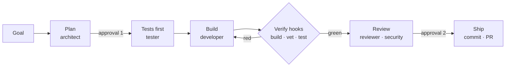

<div align="center">

# Jigkit

**A drop-in workflow kit for Claude Code: skills, agents, rules and guard hooks that work in any project.**

[](LICENSE)
[](https://docs.claude.com/en/docs/claude-code)
[](install.py)
[](https://github.com/giangtv270304/jigkit/actions/workflows/ci.yml)

[Quick start](#quick-start) · [How a task runs](#how-a-task-runs) · [What's inside](#whats-inside) · [Make it yours](#make-it-yours) · [Layout](#full-layout)

</div>

---

## Why

- **One task, one file.** `/work` keeps goal, plan, tests, review and hand-off in a single `TASK.md`, with two approval stops.
- **Guardrails, not prompts.** Hooks block force pushes, `.env` reads, edits outside the plan and stopping while the build is red.
- **Project-agnostic.** Nothing project-specific lives here; each project adds a short `.claude/project.md`.

## Quick start

```bash
git clone https://github.com/giangtv270304/jigkit ~/jigkit
```

```bash
~/jigkit/install.py           # dry run: one row per item, nothing written
```

```bash
~/jigkit/install.py --apply   # link into ~/.claude and merge settings
```

`--apply` links skills, agents, rules and output styles into `~/.claude/`, links `~/.claude/devkit` to the repo, and merges `settings/user.fragment.json` into `~/.claude/settings.json` (backup written first). It never overwrites a file it did not create.

| Action | Command |
|---|---|
| Update | `git pull` (links apply next session; re-run `--apply` only if files were added or the settings fragment changed) |
| Agents missing | `./install.py --apply --copy-agents` (copies instead of links; re-run after each pull) |
| Uninstall | `./install.py --uninstall --apply` |

> [!IMPORTANT]
> The rules apply to **every** project and session. Read [Make it yours](#make-it-yours) before `--apply`.

## How a task runs



Every step writes to the same `TASK.md`. Agents report `DONE`, `DONE_WITH_CONCERNS`, `NEEDS_REPLAN` or `BLOCKED`; only the coordinator edits the file. Inside [Herdr](#herdr-optional) each step runs in a visible pane instead of a subagent.

## What's inside

### Commands you type

| Skill | Does |
|---|---|
| `/work` | Runs one task end to end in `TASK.md` |
| `/lead` | Coordinates a whole project from a Herdr tab, memory in `LEAD.md` |
| `/design` | Options, non-functional needs, ADR with diagrams |
| `/review-pr` | Reviews someone else's PR in its own worktree |
| `/research` | Sourced answers at three depths |
| `/brainstorm` | Vague idea → decision record |
| `/retro` | Traces session friction to rule/skill text, fixes on a `retro/<date>` branch |

### Loaded automatically when relevant

| Group | Skills |
|---|---|
| Conventions | `go-service`, `sdk-wrapper`, `data-design`, `ops-change`, `frontend-change` |
| Methods | `tdd`, `debug`, `perf`, `dependency-upgrade`, `cross-repo-change`, `refresh-context`, `visual-plan`, `code-graph` |
| PR upkeep | `address-review`, `fix-ci`, `resolve-conflicts` |
| Safety | `vet-third-party` (audits a plugin, skill or MCP before install) |

### Guard hooks

| Hook | Stops |
|---|---|
| `bash-guard.sh` | force push, `reset --hard`, `clean -fd`, `branch -D`, unsafe `rm -rf`, real `.env` reads |
| `plan_gate.py` | code agents editing files the plan does not list, or editing on `main` |
| `verify_before_stop.py` | code agents stopping while `go build/vet/test` or Node `type-check`/`test` fail |
| `comment-guard.sh` | new code comments that break `rules/comments.md` |
| `herdr_agent_gate.py` | hidden subagents inside Herdr (work runs in visible panes) |
| `.githooks/`, `git-local/` | secrets, IPs, denylisted names, AI files and bad commit messages reaching git |

Also: 6 agents (`architect`, `tester`, `developer`, `reviewer`, `security-reviewer`, `improver`), 12 rules and 2 output styles (`engineer-brief`, `plain-words`).

## Make it yours

This is one person's setup, shared as is. Fork it and change these before `--apply`:

| File | Change |
|---|---|
| `rules/preferences.md` | GitHub account in the commit/push policy, or "push without asking" never applies |
| `output-styles/`, `rules/writing-vi.md` | Reply language (default Vietnamese) |
| `hooks/obsidian_daily.py` | Writes session notes to `OBSIDIAN_VAULT`. Set `OBSIDIAN_DAILY=off` or drop it from `settings/user.fragment.json` |
| `denylist.example.txt` | Copy to `~/.config/devkit/denylist.txt` with names your commits must never carry |

Once per clone, enable this repo's own git hooks:

```bash
git -C ~/jigkit config core.hooksPath .githooks
```

### Per project

```bash
cp ~/jigkit/templates/project.md <project>/.claude/project.md   # fill in what differs
```

```bash
~/jigkit/git-local/install.sh <repo or folder of repos>          # keep AI files out of git
```

`git-local/install.sh` copies the hooks, so re-run it after changing them.

<details>
<summary><b>Go language server (optional)</b></summary>

`--apply` enables the official `gopls-lsp` plugin but does not install it:

```sh
claude plugin install gopls-lsp@claude-plugins-official
go install golang.org/x/tools/gopls@latest   # gopls must be on PATH
```

Remove with `claude plugin uninstall gopls-lsp`. A value you set to `false` in `enabledPlugins` is kept.

</details>

<a name="herdr-optional"></a>
<details>
<summary><b>Herdr (optional)</b></summary>

`rules/herdr.md` and `skills/herdr-dispatch` act only inside the Herdr app; elsewhere they fall back to subagents.

- `herdr-dispatch` opens agents as panes: `helper` (one-off, read-only by default), `worker` (a plan step), `reviewer` (reviews by `agents/reviewer.md` or `security-reviewer.md`).
- In one repo, each independent step gets its own worktree (`dispatch.py --worktree <branch>`). The lead merges in plan order and removes a worktree only after its branch is merged.
- A repo another task is using (off its default branch, dirty, or with an agent in it) always gets a worktree.
- Worktrees go to `worktrees.directory` in `~/.config/herdr-app/settings.json` (default `~/.herdr/worktrees`). Claude asks to trust each new worktree, so the agent shows Blocked until you answer.
- `bin/herdr-task <slug> [first message] [--root DIR]` opens a Herdr space with a lead `claude`.

</details>

<a name="full-layout"></a>
<details>
<summary><b>Full layout</b></summary>

| Path | What |
|---|---|
| `skills/` | 24 skills, one folder each with `SKILL.md` |
| `agents/` | architect, tester, developer, reviewer, security-reviewer, improver |
| `rules/` | comments, commits, Go, pull requests, review levels, writing style, preferences, diagrams, instructions, writing-instructions, library-apis, herdr |
| `output-styles/` | `engineer-brief`, `plain-words` |
| `hooks/` | Claude Code hooks; `task_log.py` and `task_resume.py` keep `TASK.md` context across stops and compactions; `format-edited-file.sh` formats edited files; `lib/` holds the shared generated-file list |
| `herdr/templates/` | `worker.md`, `reviewer.md`, `helper.md`, linked to `~/.config/herdr-core/templates/` |
| `bin/herdr-task` | Herdr space launcher, linked to `~/.local/bin/` |
| `templates/` | `project.md` and `adr.md` starting points |
| `settings/user.fragment.json` | hooks, deny rules and plugins merged into `~/.claude/settings.json` |
| `git-local/` | per-repo hooks: hide AI files, block pushing them or secrets (`gitleaks` if installed), check commit messages |
| `.githooks/` | this repo's `pre-commit` and `commit-msg` |
| `tests/`, `Makefile` | unit tests and lint |

</details>

## Development

```bash
make test   # unit tests
```

```bash
make lint   # bash -n, py_compile, shellcheck and ruff when installed
```

Repo rules:

- No company, client, repo, service or vendor names. No secrets, no real `.env`.
- No vendored third-party code, except MIT/Apache text copied with source and license noted. Official plugins are enabled via `settings/user.fragment.json`.
- Lowercase, hyphenated file names, except `SKILL.md`, `README.md` and generated `TASK.md`.

## License

[MIT](LICENSE)
