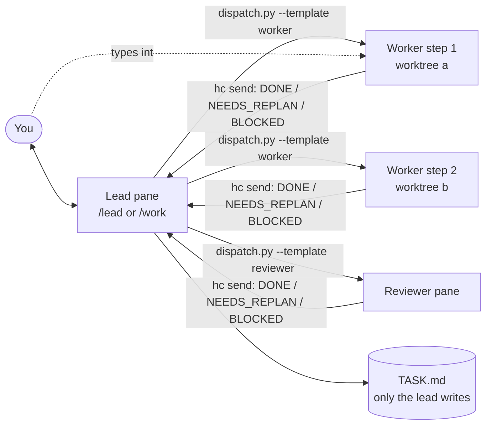

# Herdr integration

**Run each agent as a real Claude session in a visible pane, instead of a hidden subagent.**

[Herdr](#what-herdr-is) is a desktop terminal app for coding agents. Inside it, Jigkit opens workers, reviewers and helpers as panes beside your lead session. You can watch them, type into them and stop them. Outside Herdr, every workflow falls back to normal subagents, so this folder is optional.

## Why use it

| Problem with subagents | What Herdr changes |
|---|---|
| They run in the background. You see only the final report. | Each agent is a pane. You watch it work as it goes. |
| You cannot step in mid-task. | Type straight into the pane. The agent logs `người dùng quyết: …` so the lead copies your decision into `TASK.md`. |
| The lead is busy until the subagent returns. | The lead dispatches and stays free for your next request (`/lead`). |
| Parallel steps in one repo overwrite each other. | `--worktree <branch>` gives each step its own git worktree. |
| A closed window or a crash loses the run. | Terminals live in `herdr-core` (`hc`) and survive the window closing. |
| A subagent is a reduced context. | A pane is a full `claude` session: skills, hooks and `plan_gate` all apply, with `DEVKIT_ROLE` set per template. |

The cost: you need the Herdr app, Claude asks you to trust each new worktree once, and at most 3 code-writing agents run at a time so you can keep up with review.

## How it fits



The lead never edits code. It opens agents, waits with `hc wait`, checks each report against `git log` and `git status`, then records the result in `TASK.md`.

## What's here

| Path | Role | Default |
|---|---|---|
| [`templates/worker.md`](templates/worker.md) | One approved plan step, test first, commits on its branch, never pushes | writes only its folder |
| [`templates/reviewer.md`](templates/reviewer.md) | Reviews the diff by `agents/reviewer.md` (or `security-reviewer.md`) | read only |
| [`templates/helper.md`](templates/helper.md) | One-off check outside any plan (logs, a query, a command) | read only |

Related files outside this folder:

| Path | What |
|---|---|
| [`../skills/herdr-dispatch`](../skills/herdr-dispatch) | `dispatch.py`: opens a pane or tab with a template, optional worktree |
| [`../skills/lead`](../skills/lead) | `/lead`: one coordinator session per project, memory in `LEAD.md` |
| [`../rules/herdr.md`](../rules/herdr.md) | When "open an agent" means a pane, not a subagent |
| [`../hooks/herdr_agent_gate.py`](../hooks/herdr_agent_gate.py) | Inside Herdr, denies developer/tester/reviewer subagents so work stays visible |
| [`../bin/herdr-task`](../bin/herdr-task) | Opens a Herdr space with a lead `claude` for a task |

## Setup

`install.py --apply` links the templates to `~/.config/herdr-core/templates/` and `bin/herdr-task` to `~/.local/bin/`. Then open the Herdr app once so `herdr-app` and `hc` are on `PATH`.

Check you are inside Herdr:

```bash
echo $HC_TERMINAL_ID   # prints an address such as t3; empty means outside Herdr
```

## Usage

Start a task in its own space:

```bash
herdr-task fix-login            # lead runs "/work fix-login" in the current folder
```

Open agents from the lead (the skills do this for you):

```bash
python3 ~/.claude/skills/herdr-dispatch/dispatch.py <repo> step-2 "<task>" --worktree <slug>/step-2
```

```bash
python3 ~/.claude/skills/herdr-dispatch/dispatch.py <repo> check-db "<task>" --template helper
```

| Command | Does |
|---|---|
| `hc ls` | List running agents |
| `hc read <t> --lines 80` | Show an agent's screen |
| `hc send <t> "…"` | Reply or hand over the next piece |
| `hc wait --children any` | Wait for any agent to report (never `sleep`) |
| `hc interrupt <t>` | Stop an agent's current turn |

## Choosing a mode

| Situation | Mode |
|---|---|
| Steps in different repos | One agent per repo, no worktree |
| Independent steps in one repo | One worktree per step: `--worktree <branch>` |
| Steps in one repo that depend on each other | One agent, next step via `hc send` |
| Repo already busy (off default branch, dirty, or another agent in it) | Always a worktree: `--worktree <slug>/<repo> --base <default branch>` |

The lead merges worktree branches in plan order and removes a worktree only after its branch is merged. Worktrees go to `worktrees.directory` in `~/.config/herdr-app/settings.json` (default `~/.herdr/worktrees`).

## What Herdr is

Herdr has two parts: `herdr-app`, the window that arranges terminals into spaces, tabs and panes, and `herdr-core` (`hc`), which keeps those terminals alive and lets programs read, message and wait on each other. Run `herdr-app --help` and `hc --help` for the full command list.
